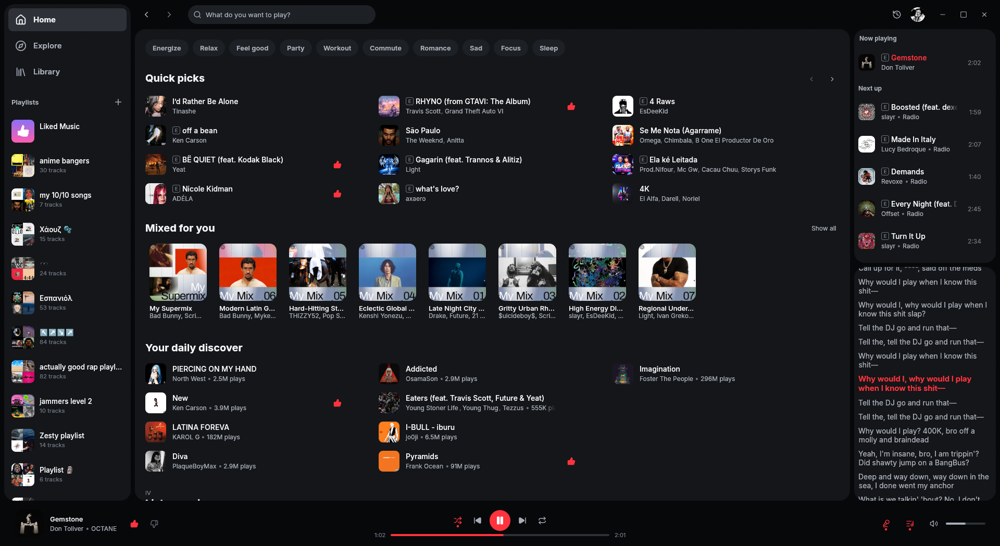
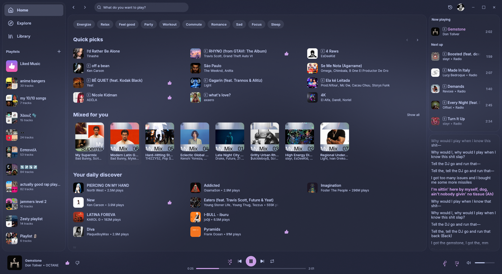

  

<h1 align="center">refryt</h1>

A native YouTube Music client for Linux, Windows and macOS.

  
  

refryt is a desktop client for YouTube Music written in Rust. There is no browser engine behind it. Playback goes through mpv, and the app talks to YouTube through the same internal API the website uses.

- Home, Explore, search, a library, synced lyrics, an editable queue and music videos.
- 22 themes, with optional window transparency and background blur.
- Memory use is typically between 100 and 300 MB, depending on the session.
- Packages for Linux (AppImage and Flatpak), Windows (installer and zip) and macOS (Apple Silicon DMG).

## Disclaimer

> [!IMPORTANT]
> refryt is not a piracy tool. It hosts, shares and unlocks no content. Every song is streamed from YouTube under the account that is signed in.

Premium: refryt is intended for use with a YouTube Premium or YouTube Music Premium subscription, which provides ad-free and background playback. Downloads are available only when the signed-in account has Premium; the app checks the account's Paid memberships page and shows the result in Settings. Downloaded files are for personal offline listening and should not be redistributed.

Account: likes, playlist edits and listening history are saved to the signed-in YouTube account, so they also appear on the website and in the mobile apps.

Affiliation: refryt is an unofficial client. It is not affiliated with, endorsed by or sponsored by YouTube or Google, and "YouTube" and "YouTube Music" are trademarks of Google LLC. The app uses YouTube's undocumented internal API, and third-party clients fall outside YouTube's Terms of Service. Use is at the user's own discretion.

## Features

- Search by type. Choosing Songs, Albums or Artists asks YouTube for that category directly, instead of filtering one mixed list.
- Playlists. They can be created, renamed and reordered by dragging. Adding a song that is already in a playlist asks first. Playlists the user owns show YouTube's suggestions, each with a + button.
- Liked songs. A liked song shows its thumb in search, on Home and in every list. Each artist page has a tile with the songs liked by that artist.
- Home order. Settings lets the user put Home's sections in any order. YouTube decides which sections exist and sends them in batches, so a section that arrives late is added below what is already on screen. The Strict Home Order switch, off by default, waits a few seconds longer for the top seven sections before Home is shown.
- Fullscreen player. It shows the cover, the song information and synced lyrics, with a queue drawer. F opens it and Esc closes it.
- Local files. A folder added in Settings can be browsed like a file tree, and any folder can become a playlist.
- Downloads, with Premium. Songs and whole pages can be saved to `~/Music/refryt` for offline listening, with tags and cover art embedded. A downloaded song plays from disk even when the connection is up.
- Offline mode. Without a connection the app shows a banner and a shortcut to the downloads, and reloads the page when the connection returns.
- Playback. mpv plays the audio, with an audio quality setting, volume normalisation from YouTube's loudness data, and autoplay that continues when the queue runs out.
- Brand accounts. If a Google account has more than one channel, the account menu at the top switches between them.
- Desktop integration. A tray icon, start on boot, media keys and the system media controls (MPRIS on Linux, SMTC on Windows, Now Playing on macOS). Discord Rich Presence is available and off by default.
- Resizable sidebars. Both sides can be dragged, and the widths are remembered. The left one folds down to an icon rail with just the navigation icons and the playlist covers.

## Using refryt

### Keyboard shortcuts

The shortcuts follow Spotify's desktop app.

| Key | Action |
|---|---|
| Space | Play or pause |
| Up / Down | Previous / next song |
| M | Mute |
| F | Open or close the fullscreen player |
| Esc | Close the queue drawer, then the fullscreen player |
| Ctrl + S | Shuffle |
| Ctrl + R | Cycle repeat mode |
| Ctrl + K or Ctrl + L | Jump to search |
| ? or F1 | Show the full list |
| F2 | Show the performance overlay |

On macOS the Ctrl shortcuts use Cmd.

A song is selected with one click and played with two, as in Spotify. The "Double-Click to Play" setting changes that so one click plays. The mouse's back and forward buttons move through the page history.

### Themes and transparency

The 22 bundled themes are plain CSS files in the `themes` folder of the config folder, and [docs/THEMES.md](docs/THEMES.md) describes the format. A theme file can be edited, added or deleted. The app reads the folder when its window regains focus and when Settings is opened. Album and playlist headers can take their colour from the cover art, which is on by default.

Settings has a transparency slider and a background blur switch. Blur depends on the compositor: it works on KDE Plasma under Wayland, in compositors that implement the ext-background-effect protocol (niri, GNOME 51 and newer), and on macOS. It has been tested on KDE Plasma. Windows has neither transparency nor blur, because the window shows a flat grey there instead of the desktop. A Card Outlines switch adds a thin edge around each panel, and it is on by default.

### Signing in

The app can sign in from its own window on Linux, Windows and macOS. It can also use the session of a browser that is already signed in: Chrome, Chromium, Firefox, Brave, Vivaldi or Edge. On Windows only Firefox is offered, because the other browsers encrypt their cookies in a way other programs cannot read. The Flatpak cannot see browser profiles, so it hides the browser option and signs in through the app's own window.

Signed out, the app still searches and plays. It has no library.

### Where the data lives

- The config folder holds the settings, the themes, the saved session, a cache of the liked songs and the log. On Linux it is `~/.config/refryt`, on macOS `~/Library/Application Support/refryt`, and in the Flatpak `~/.var/app/io.github.gridoe.refryt/config/refryt`.
- The session is a cookie stored with owner-only permissions, since it works like a password.
- Downloads go to `~/Music/refryt`.

The app has no telemetry. It connects to YouTube, to [LRCLIB](https://lrclib.net) for synced lyrics, and to Discord's local client when Rich Presence is turned on. After a crash it writes a report to the config folder and offers it on the next launch, to copy or to open as a prefilled GitHub issue. Nothing is sent automatically.

## Status

The project is before 1.0 and changes quickly.

| Platform | Package | State |
|---|---|---|
| Linux | AppImage, Flatpak | Used and tested regularly |
| Windows | Installer, zip | Cross-compiled from the Linux sources; limited testing on real hardware |
| macOS | DMG, Apple Silicon only | Home, playback, the tray, the sign-in window, transparency and blur tested by hand; media keys, Now Playing and the browser cookie import untested |

Podcasts are not supported. YouTube changes its internal API without notice, and a change can break playback or a page until a fix is released, usually within a few days.

## Install

Packages are on the [releases page](https://github.com/gridoe/refryt/releases).

### macOS

1. Download `refryt-<version>-macos-arm64.dmg`. It is built for Apple Silicon only.
2. Open the image and drag Refryt to Applications.
3. The app is signed ad hoc and not notarised, so macOS refuses the first launch. Run `xattr -cr /Applications/Refryt.app` once, or allow the app in System Settings under Privacy & Security.

libmpv and yt-dlp are bundled in the app.

### Linux, AppImage

1. Download `refryt-<version>-x86_64.AppImage`.
2. Make it executable with `chmod +x` and run it.

From a source checkout, `./scripts/appimage-install.sh install` copies the AppImage to `~/.local/bin` and adds a launcher entry and icons, and `./scripts/appimage-install.sh uninstall` removes them. Uninstalling leaves `~/.config/refryt` and the downloads in place.

### Linux, Flatpak

1. Download `refryt-<version>-x86_64.flatpak`. It is not on Flathub, so it is installed from the file.
2. Run `flatpak install --user refryt-<version>-x86_64.flatpak`. Flatpak offers to fetch the GNOME 49 runtime the first time.
3. Start it with `flatpak run io.github.gridoe.refryt`.

mpv and yt-dlp are included. Inside the sandbox the browser import and the Launch on Startup setting are hidden, because neither can work there.

### Windows

1. Download `refryt-<version>-windows-x86_64-setup.exe` and run it. It installs to Program Files, adds a Start menu entry and registers an uninstaller. The installer is unsigned, so SmartScreen warns on the first run.
2. Alternatively, download `refryt-<version>-windows-x86_64.zip`, extract the whole folder and run `refryt.exe`. The executable needs the DLLs next to it.

To build any of these from source, see the next section.

## Build from source

The repository is a Cargo workspace with a `Justfile`. `just` builds and runs the app, `just release` makes the optimised build, and `just check` runs formatting, clippy and the tests. Building needs Rust and libmpv. yt-dlp is optional; playback falls back to it when YouTube does not return a stream directly. [docs/BUILDING.md](docs/BUILDING.md) covers the full setup, the Windows cross-build, the Flatpak and the release process.

The app is built with:

- Rust, with [`egui`/`eframe`](https://github.com/emilk/egui) for the interface
- [`mpv`](https://mpv.io/) through `libmpv2` for playback
- YouTube's own `player` endpoint for streams, with [`yt-dlp`](https://github.com/yt-dlp/yt-dlp) as the fallback
- [`ytmapi-rs`](https://github.com/nick42d/youtui) for YouTube Music's InnerTube API
- `tokio` and `reqwest` with `rustls` for networking
- `glow` (OpenGL) for drawing on Linux, and `wgpu` on Windows (DirectX 12) and macOS (Metal)
- `lofty`, `walkdir` and `rfd` for local files

## Credits

- **[Sonora](https://github.com/sonorahq/sonora)** and its
  [`ytmusic-rs`](https://github.com/sonorahq/ytmusic-rs): asking YouTube's `player` endpoint
  as the visionOS client, which hands back direct stream URLs, and retrying with the visitor
  id a refusal issues.
- **[yt-dlp](https://github.com/yt-dlp/yt-dlp)**: the fallback resolver, and the reference
  for how YouTube gates anonymous clients.
- **[youtui](https://github.com/nick42d/youtui)**: `ytmapi-rs` for the InnerTube API, and its
  maintained `rusty_ytdl` fork behind the optional native resolver.
- **[ytmdesktop](https://github.com/ytmdesktop/ytmdesktop)**: what happens when the queue
  runs out.
- **Spotify's desktop app**: the shortcuts, select-then-play clicks, and the shape of the
  album, playlist and artist pages.
- **[LRCLIB](https://lrclib.net)**: the synced lyrics.
- **Theme palettes**: [Catppuccin](https://github.com/catppuccin/palette),
  [Nord](https://www.nordtheme.com/docs/colors-and-palettes),
  [Gruvbox](https://github.com/morhetz/gruvbox),
  [Tokyo Night](https://github.com/folke/tokyonight.nvim),
  [Dracula](https://spec.draculatheme.com), [Rosé Pine](https://github.com/rose-pine/palette),
  [Everforest](https://github.com/sainnhe/everforest) and
  [Solarized](https://ethanschoonover.com/solarized). Each file in `crates/refryt/themes`
  names its source.

## Licence

[GPL-3.0-or-later](LICENSE).
